# Library Management App — Project Documentation

## 1. Introduction

The Library Management App is a web-based system for a college library. It automates cataloguing, circulation (issue, renewal, return, reservation), late fines, payments, members and library settings. Its interface is the SmartLib design: a dark navy / teal / gold dashboard with a fixed sidebar. That UI is backed by a new Node.js + Express REST API on a MySQL 8 database. The UI is in English by default, with Hungarian selectable at runtime, and all money is in Indian rupees (₹).

Every book has a price and an exact shelf location: floor → section → shelf → rack → row → position. A librarian can issue a copy after automatic eligibility checks. At the return desk the late fee is previewed before the return is confirmed. Fines can be paid in full, in part, discounted or waived, and every change is reflected immediately on the dashboard and in reports.

**Scope.** Four roles (Admin, Librarian, Staff, Student), 16 pages, 15 REST routers with 65 endpoints, and 13 MySQL tables.

| Layer | Technology |
|---|---|
| Frontend | HTML5, CSS3, vanilla JavaScript (ES modules), Chart.js, jsPDF, qrcode.js, JsBarcode, html5-qrcode (CDN, loaded on demand) |
| Backend | Node.js 18+, Express 4 |
| Database | MySQL 8 (InnoDB, utf8mb4) via `mysql2`, pool of 10 connections |
| Security | JWT (7-day), bcrypt (`bcryptjs`), Helmet, CORS, express-rate-limit, express-validator, parameterised SQL |

## 2. Problem Statement & Objectives

### 2.1 Problem statement
- Books are hard to find: paper records hold no exact physical position.
- Issue and due dates are tracked by hand, so overdue loans are noticed late.
- Late, lost and damage charges are calculated by hand and inconsistently.
- Copy counts drift away from what is actually on the shelves.
- There are no reports on popular titles, shelf use, overdue trends or money collected.
- There is no access control over who may change records.

### 2.2 Objectives
1. A central catalogue with price and exact shelf location for every book.
2. Automated issue, renewal, return and reservation with eligibility checks (membership status and expiry, book limit, outstanding dues, availability).
3. Automatic fines: **₹10 per day late** (configurable), damage at a percentage of the price, lost books at price + processing fee.
4. Payments by Cash, UPI, Card or Bank Transfer, including partial payments, discounts, waivers, receipts and pending transfers.
5. Role-based access for Admin, Librarian, Staff and Student.
6. A live dashboard and nine exportable reports (print, CSV, PDF).
7. Live search, a shelf map, QR / barcode lookup and a natural-language assistant.
8. Automatic in-app notifications; a Hungarian / English interface; responsive down to 390 px.

## 3. System Analysis & Design

### 3.1 Existing vs proposed system

| Aspect | Existing (manual) | Proposed |
|---|---|---|
| Book location | Section label only | Floor → section → shelf → rack → row → position, shelf map |
| Circulation | Paper register | Transactional issue / renew / return / reservation queue |
| Fines | By hand | Calculated on return from the policy settings; previewed first |
| Availability | Counted occasionally | Copy counters recomputed inside every transaction |
| Reports | None | Live dashboard + 9 reports (print / CSV / PDF) |
| Access | Anyone with the register | JWT login, four roles, server-side checks on every route |

### 3.2 Feasibility
- **Technical:** mature open-source stack; runs on any machine with Node.js 18+ and MySQL 8.
- **Economic:** all components are free.
- **Operational:** browser only, nothing to install for staff; seeded demo accounts for training.

### 3.3 Requirements

**Functional**
1. Users log in with an email or user ID and see only what their role allows.
2. Librarians manage books, authors, categories and shelves, including bulk move, re-categorise and delete.
3. Staff issue (also back-dated), renew and return books, manage members and reservations, and record payments.
4. Late, damage and lost fines are calculated on return; payments update fine status and produce receipts.
5. An hourly job marks overdue loans, sends due-soon and overdue notices, expires memberships and lapsed reservation holds, and passes freed copies to the next member in the queue.
6. Admins change library policy, manage user accounts and write data backups to a configured server folder.

**Non-functional**
- **Security:** bcrypt hashes; signed JWTs; role checks and student data-scoping on the server; validation on every write; parameterised SQL only; rate limits on login.
- **Reliability:** foreign keys, CHECK constraints and InnoDB transactions with row locks (`SELECT … FOR UPDATE`), so a failed issue or return rolls back completely.
- **Usability:** dark, light and system themes; Hungarian / English; keyboard shortcuts (Ctrl K); reduced-motion support; no horizontal scroll at 390 px.
- **Performance:** paginated list endpoints, indexed columns, pooled connections.

### 3.4 User roles

| Role | Permissions |
|---|---|
| Admin | Everything, including library policy, backups and user accounts |
| Librarian | Catalogue CRUD, circulation, member deletion, fine discounts and waivers |
| Staff | Issue / return / renew, members, reservations pickup, payments, manual charges, moving books |
| Student | Browse, reserve, renew own loans, view own loans, fines and payments, AI assistant |

### 3.5 Modules
1. **Authentication**: login by email or ID, self-registration, profile and photo, password change, user accounts.
2. **Catalogue**: books, authors, categories, shelves with capacity and occupancy.
3. **Members**: profiles with Neptun code, membership type, status and expiry, renewal with fee.
4. **Circulation**: issues, renewals, returns with fee preview, reservation queue and holds.
5. **Finance**: fines (late, damage, lost, manual), discounts, waivers, payments, receipts.
6. **Notifications**: automatic events, staff broadcasts, per-user read state.
7. **Reports & dashboard**: statistics, charts, nine reports.
8. **AI assistant & recommendations**: rule-based intents over live SQL; personalised picks.
9. **Settings**: policy values, backup folder, theme, language.

### 3.6 Architecture

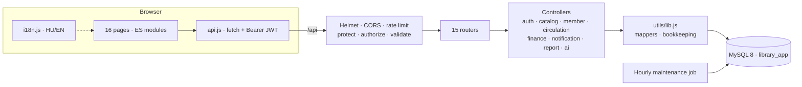

### 3.7 Database design

Database `library_app`: 13 InnoDB tables in utf8mb4, normalised to 3NF, with enforced foreign keys (`database/mysql/schema.sql`).

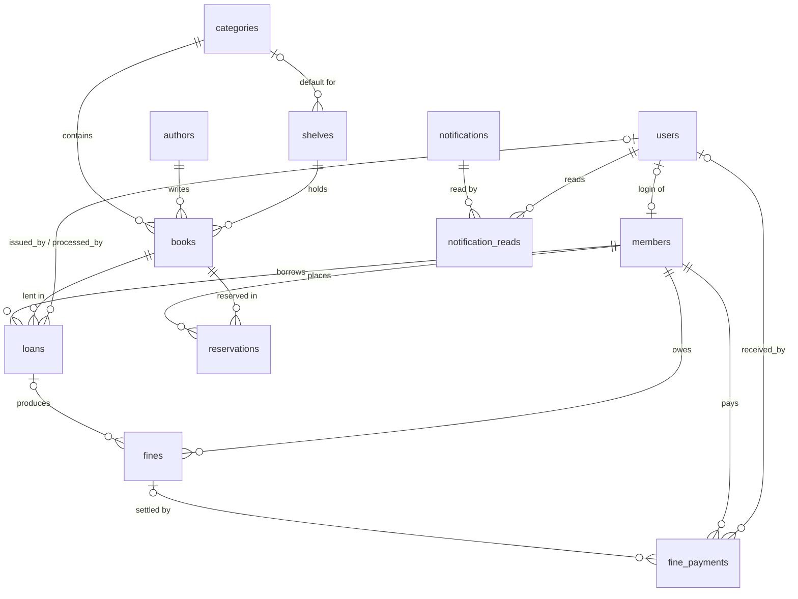

| Table | Key columns | Constraints |
|---|---|---|
| users | name, email (unique), password_hash, role, avatar, is_active, search_history, last_login | role ENUM admin/librarian/staff/student |
| members | member_code, user_id, name, email, phone, **neptun_code**, department, course, year, membership_type, membership_start/expiry, status | user_id unique, ON DELETE SET NULL; neptun_code unique; CHECK expiry > start |
| authors | author_code, name (unique), biography, country, profile_image | — |
| categories | category_code, name (unique), description, icon, subcategories (JSON) | — |
| shelves | code (unique), name, floor, section, racks, rows_per_rack, category_id, capacity, status | CHECK capacity > 0, rows 1–26 |
| books | book_code, title, isbn (unique), author_id, category_id, price, quantity, available/issued/reserved/lost/damaged copies, status, times_borrowed, shelf_id, rack, shelf_row, position | CHECK 0 ≤ available ≤ quantity, counters ≥ 0, prices ≥ 0; shelf ON DELETE SET NULL |
| loans | transaction_id, member_id, book_id, issued_by, issue/due/return dates, renewal_count, status, return_condition, days_overdue, late/damage/lost charges, fine_amount | member/book ON DELETE RESTRICT; CHECK due > issue, return ≥ issue |
| reservations | reservation_code, member_id, book_id, queue_position, expiry_date, available_since, status | generated `active_reservation_status` + UNIQUE → one active reservation per member and book |
| fines | fine_code, member_id, loan_id, book_id, type, description, original_amount, discount, paid_amount, waived_amount, status | CHECK discount + paid + waived ≤ original |
| fine_payments | payment_code, receipt_no, member_id, fine_id (NULL = membership fee), amount, method, status, reference, received_by | CHECK amount > 0 |
| notifications | audience (all/staff/member), member_id, type, title, message, link | member ON DELETE CASCADE |
| notification_reads | (notification_id, user_id) | composite PK |
| settings | setting_key, setting_value | policy key/value |

The one-active-reservation rule uses a generated column, because MySQL has no filtered unique index; NULLs never clash:

```sql
active_reservation_status VARCHAR(10)
  GENERATED ALWAYS AS (IF(status IN ('Waiting','Available'), 'active', NULL)) VIRTUAL,
CONSTRAINT uq_active_book_member_reservation UNIQUE (book_id, member_id, active_reservation_status)
```

### 3.8 API design

All routes are under `/api` and return JSON: `{ success, data, pagination? }` on success, `{ success: false, message, details? }` with 400 / 401 / 403 / 404 / 409 on errors. `details` maps field names to messages, which the forms show under each field. List endpoints take `page` and `limit`. Every route except login, register and health needs `Authorization: Bearer <token>`.

| Router | Endpoints |
|---|---|
| auth | POST login, register · GET me · PUT profile · PATCH password · POST search-history · GET/POST users, PATCH users/:id (admin) |
| books | GET / (search, category, author, language, floor, shelf, rack, price, status, sort) · GET meta, recommendations, :id · POST / , bulk · PUT :id · PATCH :id/location · DELETE :id |
| authors / categories / shelves | GET, GET :id, POST, PUT :id, DELETE :id |
| members | GET / (search, status, type, sort), GET :id (loans, fines, payments, reservations), POST, PUT :id, PATCH :id/renew, DELETE :id |
| issues | GET / , GET :id, POST / (issue), PATCH :id/renew |
| returns | GET lookup?q= (late-fee preview), GET / , POST / |
| reservations | GET, POST, PATCH :id/cancel, PATCH :id/collect, DELETE :id |
| fines | GET, GET summary, POST (manual charge), PATCH :id/discount, PATCH :id/waive |
| payments | GET (with totals), GET :id (receipt), POST, PATCH :id/confirm |
| notifications | GET, GET unread-count, PATCH read-all, PATCH :id/read, POST (broadcast), DELETE :id |
| settings | GET, PUT (admin), POST backup (admin) |
| reports | GET dashboard, GET / , GET :type (books, issued, returned, overdue, fines, payments, members, popular, shelves) |
| ai | POST query |

## 4. Implementation

### 4.1 Project structure

```
library-app/
├── package.json, .env.example, README.md, PROGRESS.md
├── database/mysql/   schema.sql (13 tables) · seed.js (demo snapshot → MySQL, ₹)
├── backend/
│   ├── server.js            Express app, static frontend, hourly job, AUTO_SEED
│   ├── config/db.js         mysql2 pool (10) · tx() transaction helper · schema check
│   ├── routes/              15 routers
│   ├── controllers/         auth · catalog · member · circulation · finance · notification · report · ai
│   ├── middleware/          auth (protect, authorize, staffOnly) · validate (express-validator) · errorHandler
│   └── utils/               lib.js (SQL, response mappers, bookkeeping) · maintenance.js · ApiError
├── frontend/                16 pages · css/ (style, dashboard, books, responsive) · js/ (app shell, api,
│                            i18n, icons, shared modals, charts, one module per page, demo/)
└── docs/                    this file · MANUAL_TEST_SCRIPT.md · screenshots/
```

### 4.2 Backend

`server.js` exits at startup if `JWT_SECRET` is missing. It checks that the schema exists, seeds an empty database when `AUTO_SEED=true`, mounts the routers, serves the frontend from the same origin, and runs the maintenance job at startup and every hour after that.

**Authentication.** Login accepts an email or a numeric user ID. Passwords are compared with bcrypt, and a JWT is signed for 7 days. `protect` verifies the token and loads the user together with their linked member. `authorize(...roles)` returns 403 for any other role. Student requests are scoped to the student's own member record inside every query, so a student never sees another member's loans, fines, payments or reservations.

**Transactions.** Every write that touches several tables runs in `tx()`: one pooled connection, `BEGIN … COMMIT`, with `SELECT … FOR UPDATE` on the book, member, loan or fine rows involved. Any error rolls the whole operation back.

**Issue.** The member must be Active and not expired, hold fewer books than `maxBooksPerMember` (default 5), and owe no more than `maxPendingFine` (default ₹500). They must not already hold this title, and a copy must be free or held for them. The due date comes from the loan length (default 14 days) or an explicit date. A back-dated issue date is allowed so paper loans can be recorded; such a loan becomes Overdue immediately if its due date has passed. The copy counters are then recomputed from the loans and reservations, and the member is notified.

**Return.** `GET /returns/lookup` previews the fee before anything changes. `POST /returns` applies:

```
Late fine     = finePerDay × daysOverdue                (₹10 × days)
Damage charge = price × damageChargePercent / 100       (30 %)
Lost charge   = price + lostProcessingFee               (+ ₹50)
```

Each non-zero charge becomes its own fine. Lost and damaged copies are counted on the book. The reservation queue then runs: the first waiting member receives a hold for `reservationHoldDays` (3) and a "Reserved book is ready" notification.

**Renewal** is refused when the loan is overdue, has reached `maxRenewals` (2), or other members are waiting for the book.

**Fines and payments.** A payment cannot exceed the remaining balance. Status is recalculated after every payment, discount or waiver (Pending → Partially Paid → Paid / Waived). Receipts are numbered `RCPT-000001` onwards. Bank transfers can be recorded as Pending and confirmed later.

**AI assistant.** Regular expressions and keywords detect the intent: location, overdue, my loans, fines, statistics, popular, new, recommendations, or a filtered search by price (₹), category, author, floor, shelf, rack, language or availability. Each intent runs a parameterised query. For example, "Where is The Alchemist?" answers "Floor 1, Fiction Section, Shelf A, Rack 03, Row B, Position 07".

### 4.3 Frontend

The SmartLib frontend is used as-is for layout and styling. `app.js` provides the page shell (sidebar, top bar, global search, notifications, theme), the auth guard and the UI kit (toasts, modals, confirm dialogs, skeletons, pagination). `api.js` attaches the token and sends the user to the login page on 401. Each page has its own module.

Changes made for this project:
- **Currency:** ₹ throughout (`inr()` formats `₹1,23,456` with Indian digit grouping; labels and form prefixes say ₹; PDF exports print `Rs.` because jsPDF's built-in fonts lack the ₹ glyph).
- **Login:** accepts an email or user ID; the forms post with `method="post"`, so credentials can never end up in a URL.
- **Issue form:** Issue date and Loan length fields; changing either updates the due date.
- **Members:** a Neptun code field, also searchable and shown on the profile and in the members list.
- **Settings:** Library policy includes the backup folder and a "Back up now" button; Appearance has a Language / Nyelv switch.
- **Hungarian:** `i18n.js` translates interface strings at render time (dictionary plus patterns for templated text such as "in 6 days"). Dates switch to `hu-HU`; library data is left untouched.
- **Fixes to the original:** an unsized icon that filled the book page; grid rules that caused horizontal scrolling at 390 px; the stale "MongoDB" wording.

### 4.4 Deployment (local)

```bash
npm install
mysql -u root -p < database/mysql/schema.sql
copy .env.example .env      # set MYSQL_PASSWORD
npm run seed:mysql
npm start                    # http://localhost:3000
```

## 5. Testing & Results

### 5.1 Approach

- **API regression:** 26 scripted checks against MySQL 9.7 on freshly seeded data, covering authentication, roles, circulation, fines, payments, the reservation queue, validation, SQL injection and backup.
- **Browser checks** with headless Chrome:
  - every page as admin and as student, with console and API errors captured;
  - side-by-side comparison with the SmartLib screenshots at the same 125 % scaling;
  - all 16 pages at 390 px, checking for horizontal overflow;
  - the Hungarian UI.

### 5.2 Test cases

The full table with inputs is in `docs/MANUAL_TEST_SCRIPT.md`. Every case passed on 2026-10-28.

| ID | Module | Case | Expected | Result |
|---|---|---|---|---|
| T01–T03b | Auth | Login by email / ID, wrong password, empty body | 200 / 200 / 401 / 400 | Pass |
| T04–T06b | Security | No token, student deletes book, student data scoping | 401 / 403 / own rows only / 403 | Pass |
| T07–T09 | Circulation | Back-dated issue → preview → return 4 days late | Overdue; ₹40 previewed and charged | Pass |
| T10, T16 | Circulation | Dues limit, book limit | Refused with reason | Pass |
| T11–T12 | Payments | Partial payment, overpayment | Partially Paid ₹20 left; 400 | Pass |
| T13 | Renewals | Renew overdue loan | Refused | Pass |
| T14 | Reservations | Return a reserved book | Next member gets a 3-day hold and a notification | Pass |
| T15 | Returns | Lost book | ₹749 + ₹50 = ₹799 | Pass |
| T17–T18 | Settings | Negative value; student edit | 400; 403 | Pass |
| T19–T22 | Catalogue | Duplicate / invalid ISBN, add with exact location, delete | 409 / 400 / created / deleted | Pass |
| T23 | Security | `' OR 1=1 --` in search | 0 rows, no error | Pass |
| T24 | Settings | Back up now | 13 tables written | Pass |
| U01–U04 | UI | All pages, 390 px, Hungarian, themes | No errors, no overflow | Pass |

### 5.3 Screenshots

| | |
|---|---|
| 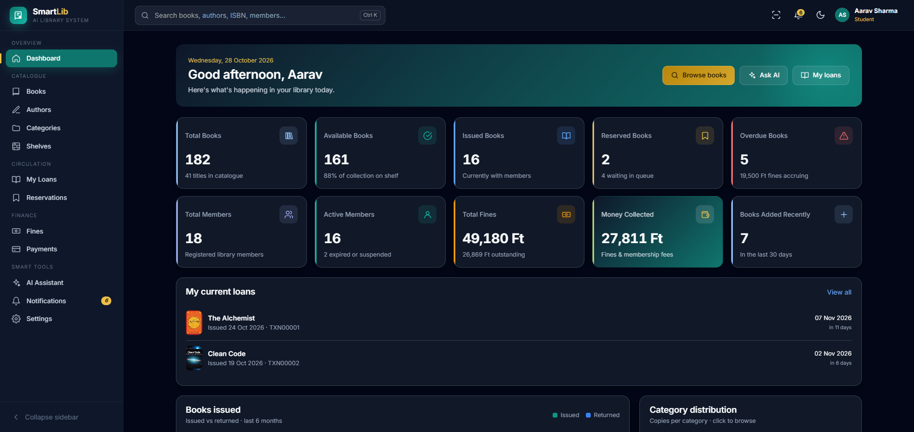 | 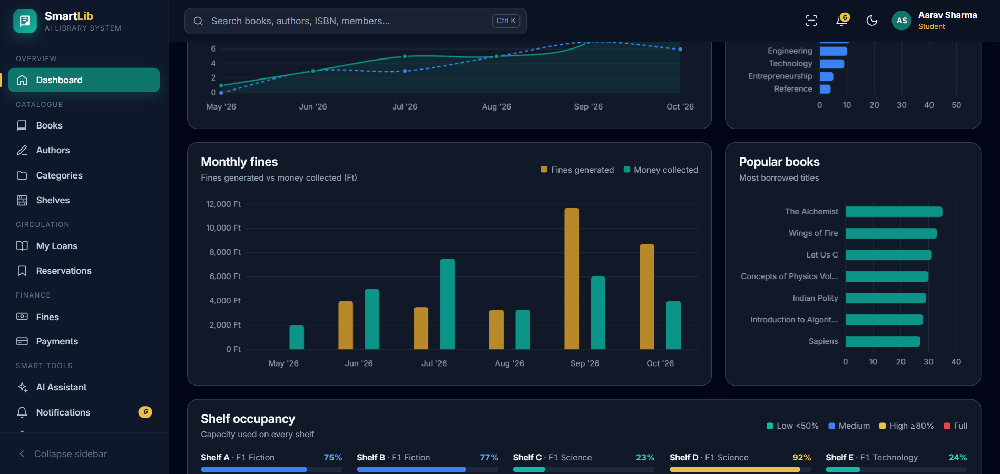 |
| Figure 1. Dashboard | Figure 2. Monthly fines, popular books, shelf occupancy |
| 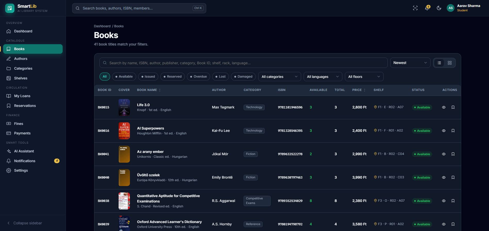 | 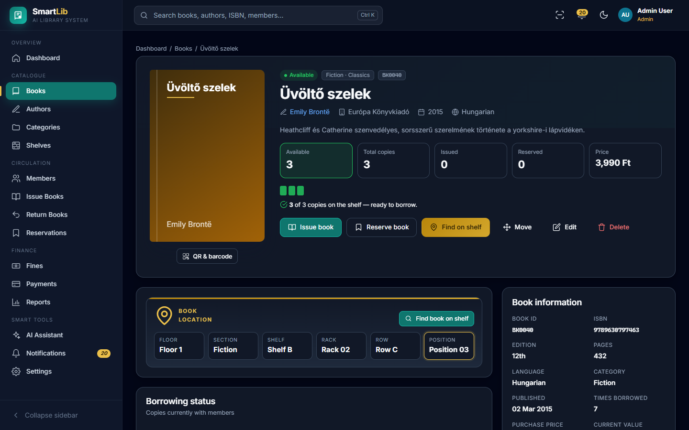 |
| Figure 3. Books catalogue with shelf codes | Figure 4. Book page with exact location |
| 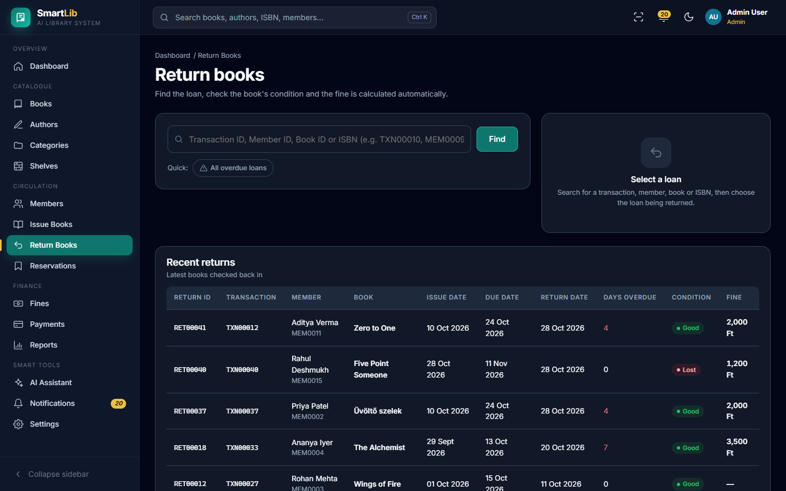 | 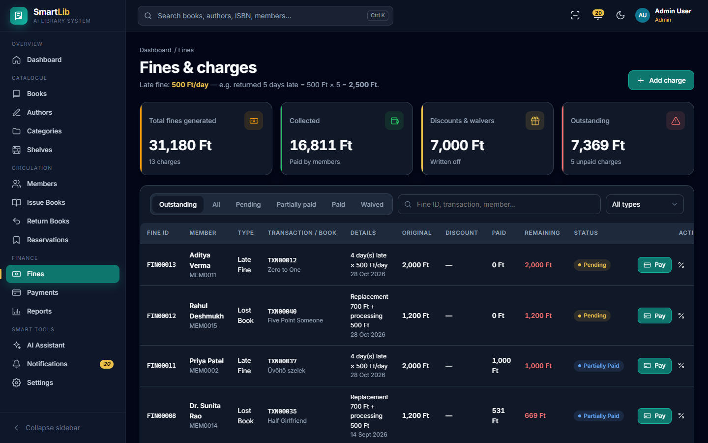 |
| Figure 5. Return desk | Figure 6. Fines |
| 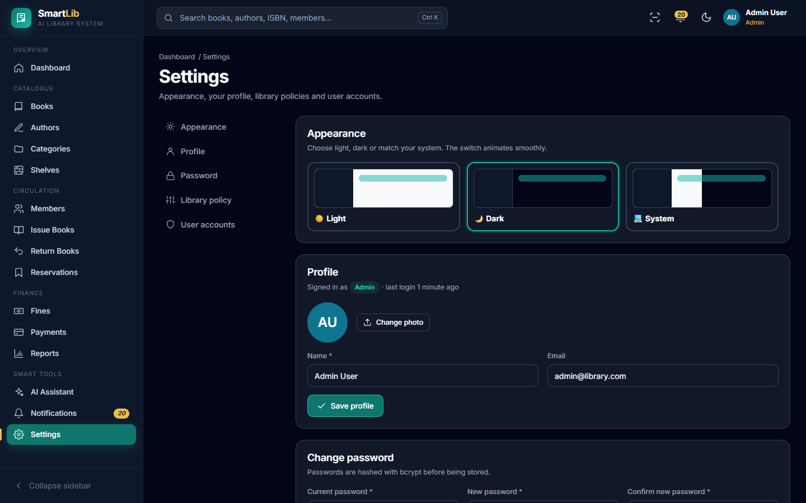 | 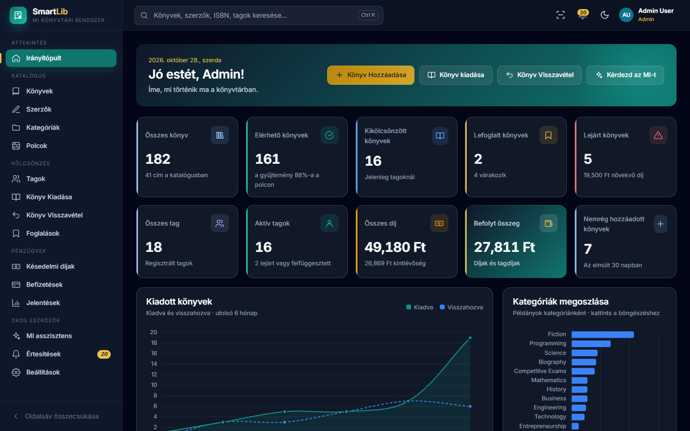 |
| Figure 7. Settings | Figure 8. Hungarian interface |
| 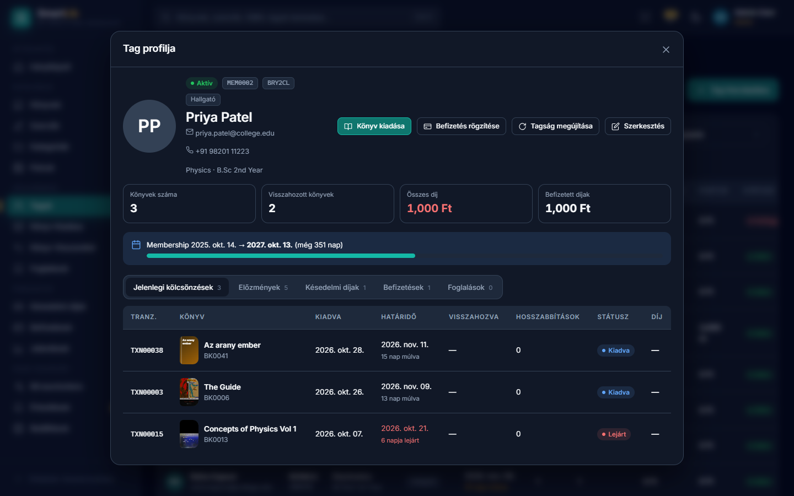 | 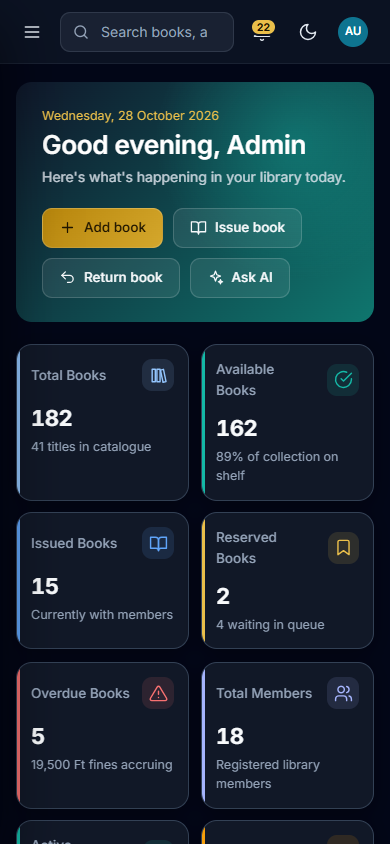 |
| Figure 9. Member profile (Neptun code) | Figure 10. 390 px layout |

### 5.4 Known limitations
- Payments are recorded only; no payment gateway is contacted.
- The AI assistant is rule-based, not a large language model, and is tuned for English questions.
- Notifications are in-app only (no email or SMS) and refresh every 60 seconds.
- Hungarian covers the interface; messages generated by the server (validation errors, notification texts) stay in English.
- Backups are JSON dumps; restoring one needs a script.
- Book covers come from Open Library by ISBN, or are uploaded as data URLs; Hungarian ISBNs usually have no Open Library cover and get a generated one.
- PDF exports use jsPDF's built-in fonts, which lack ő and ű, so these print as ö and ü.

## 6. Conclusion & Future Scope

### 6.1 Conclusion
The app replaces a manual register with a secure web system. It records the exact place of every book, enforces borrowing rules automatically, previews and calculates fines from editable policy, and keeps copy counts correct through database transactions. It has the familiar SmartLib interface in English or Hungarian.

### 6.2 Future scope
- Real payment gateway; email and SMS reminders.
- Translated server messages; a Hungarian-aware assistant.
- SQL backups with one-click restore.
- Automated tests (Jest + Supertest) in CI.
- Object storage for covers and photos.
- Multi-branch catalogue.

## 7. References
1. Node.js — nodejs.org/docs
2. Express — expressjs.com
3. MySQL 8.0 Reference Manual — dev.mysql.com/doc/refman/8.0/en
4. mysql2 — sidorares.github.io/node-mysql2/docs
5. JSON Web Tokens, RFC 7519 — datatracker.ietf.org/doc/html/rfc7519
6. Helmet — helmetjs.github.io · express-validator — express-validator.github.io
7. OWASP SQL Injection Prevention Cheat Sheet — cheatsheetseries.owasp.org
8. Chart.js — chartjs.org/docs · jsPDF — github.com/parallax/jsPDF
9. SmartLib — Project Documentation (reference design)
